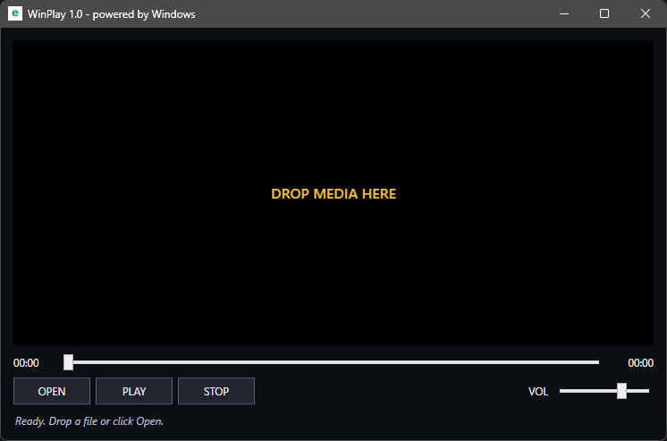

# WinPlay

WinPlay is a tiny and minimalist media player built exclusively for Windows.

It uses the native Windows multimedia components, so no FFmpeg, external codecs, libraries, or installation are required.

## Antivirus Notice (False Positives)

The `.exe` binary is generated, which some sensitive antivirus engines, including Windows Defender or machine-learning based scanners, may flag as a false positive.

The underlying PowerShell script is clean.If your system blocks the `.exe`, you can safely run the raw `WinPlay.ps1` script instead.

## Screenshot

## Features

- Video and audio playback
- Drag and drop
- Play, pause, and stop
- Seek bar with playback time
- Volume control and mute
- Fullscreen mode
- Keyboard shortcuts
- Hardware-accelerated playback when supported by Windows
- Automatic sleep prevention during playback
- Compact dark interface
- Single portable executable

## Keyboard shortcuts

- `Space` – Play / Pause
- `Left` / `Right` – Seek 5 seconds
- `Up` / `Down` – Adjust volume
- `M` – Mute
- `F11` – Fullscreen
- `Esc` – Exit fullscreen
- `Ctrl+O` – Open media

## Requirements

- Windows 10 or Windows 11
- Windows PowerShell 5.1 for the script version
- Playback support depends on the codecs and multimedia components available in Windows

## Usage

Open a media file using the **OPEN** button or simply drag and drop it into the WinPlay window.

## Philosophy

WinPlay does not bundle its own playback engine. It provides a minimal interface for the multimedia capabilities already available in Windows.

Small application. Native Windows playback.

## License

MIT License

Copyright (c) 2026 Jan Simak

Permission is hereby granted, free of charge, to any person obtaining a copy
of this software and associated documentation files (the "Software"), to deal
in the Software without restriction, including without limitation the rights
to use, copy, modify, merge, publish, distribute, sublicense, and/or sell
copies of the Software, and to permit persons to whom the Software is
furnished to do so, subject to the following conditions:

The above copyright notice and this permission notice shall be included in all
copies or substantial portions of the Software.

THE SOFTWARE IS PROVIDED "AS IS", WITHOUT WARRANTY OF ANY KIND, EXPRESS OR
IMPLIED, INCLUDING BUT NOT LIMITED TO THE WARRANTIES OF MERCHANTABILITY,
FITNESS FOR A PARTICULAR PURPOSE AND NONINFRINGEMENT. IN NO EVENT SHALL THE
AUTHORS OR COPYRIGHT HOLDERS BE LIABLE FOR ANY CLAIM, DAMAGES OR OTHER
LIABILITY, WHETHER IN AN ACTION OF CONTRACT, TORT OR OTHERWISE, ARISING FROM,
OUT OF OR IN CONNECTION WITH THE SOFTWARE OR THE USE OR OTHER DEALINGS IN THE
SOFTWARE.
